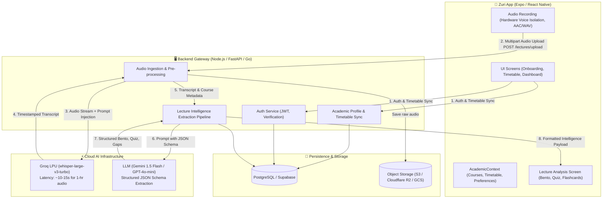

# Zuri 🎓⚡

> **An AI-powered academic companion and lecture intelligence mobile app built with Expo, React Native, and TypeScript.**  
> Designed specifically for tertiary education environments, Zuri records lectures in noisy hall environments, isolates voices, transcribes speech with specialized academic vocabulary recognition, and synthesizes structured post-lecture intelligence (Bento summaries, diagnostic quizzes, knowledge gap analysis, and flashcards).

---

## 📑 Table of Contents

- [System Architecture](#system-architecture)
- [Backend Integration Guide (API Specification)](#backend-integration-guide-api-specification)
  - [1. Authentication & Onboarding](#1-authentication--onboarding)
  - [2. Student Academic State & Timetable](#2-student-academic-state--timetable)
  - [3. Lecture Audio Ingestion & Transcription](#3-lecture-audio-ingestion--transcription)
  - [4. Post-Lecture Intelligence (Structured JSON Schema)](#4-post-lecture-intelligence-structured-json-schema)
  - [5. AI Academic Chat ("Ask Zuri")](#5-ai-academic-chat-ask-lexi)
- [Mobile Frontend Architecture](#mobile-frontend-architecture)
  - [Directory Structure](#directory-structure)
  - [Key Frontend Technologies](#key-frontend-technologies)
- [Getting Started & Local Development](#getting-started--local-development)
  - [Prerequisites](#prerequisites)
  - [Installation & Setup](#installation--setup)
  - [Running the App](#running-the-app)
- [Environment Variables](#environment-variables)
- [Audio Processing & DSP Benchmarks](#audio-processing--dsp-benchmarks)
- [Production & EAS Builds](#production--eas-builds)

---

## 🏛 System Architecture

The following diagram outlines how the mobile front-end interacts with your backend services and AI pipeline:



---

## 🔌 Backend Integration Guide (API Specification)

If you are developing or connecting an existing backend to Zuri, this section details the expected REST endpoints, request payloads, and response structures.

### Environment Variable for Mobile API
Set the backend URL in `.env`:
```env
EXPO_PUBLIC_API_BASE_URL=https://api.lexi.yourdomain.com/v1
EXPO_PUBLIC_WS_BASE_URL=wss://api.lexi.yourdomain.com/ws
```

---

### 1. Authentication & Onboarding

#### `POST /auth/register`
Creates a student account with their academic profile details collected during the onboarding flow.

**Request Payload:**
```json
{
  "email": "student@university.edu.ng",
  "password": "StrongPassword123!",
  "fullName": "Marvellous Adeyemi",
  "university": "University of Lagos",
  "department": "Computer Science",
  "level": "300L",
  "role": "student"
}
```

**Response (`201 Created`):**
```json
{
  "status": "success",
  "data": {
    "token": "eyJhbGciOi...",
    "refreshToken": "d8a1c...",
    "user": {
      "id": "usr_9981",
      "email": "student@university.edu.ng",
      "fullName": "Marvellous Adeyemi",
      "university": "University of Lagos",
      "department": "Computer Science",
      "level": "300L"
    }
  }
}
```

#### `POST /auth/login`
Authenticates existing users.
```json
{
  "email": "student@university.edu.ng",
  "password": "StrongPassword123!"
}
```

#### `POST /auth/verify-otp`
Verifies user's email via 6-digit verification code.
```json
{
  "email": "student@university.edu.ng",
  "code": "482910"
}
```

---

### 2. Student Academic State & Timetable

The mobile app maintains local state via `AcademicContext` (`src/context/academic-context.tsx`) and synchronizes with the backend.

#### `GET /students/me/academic-profile`
Retrieves registered courses, timetable slots, and target study preferences.

**Response (`200 OK`):**
```json
{
  "status": "success",
  "data": {
    "university": "University of Lagos",
    "department": "Computer Science",
    "level": "300L",
    "semester": "First Semester",
    "preferences": {
      "targetGpa": "4.50+ (First Class)",
      "weeklyStudyHours": 16,
      "lectureReminders": true,
      "reminderLeadMinutes": 15,
      "examCountdown": true,
      "assignmentAlerts": true
    },
    "courses": [
      {
        "id": "c1",
        "code": "CSC 301",
        "title": "Data Structures & Algorithms",
        "units": 3,
        "lecturer": "Dr. Adeyemi",
        "color": "#2c3930"
      }
    ],
    "timetable": [
      {
        "id": "t1",
        "courseId": "c1",
        "courseCode": "CSC 301",
        "day": "Mon",
        "startTime": "09:00 AM",
        "endTime": "11:00 AM",
        "venue": "Faculty Lab 2"
      }
    ]
  }
}
```

#### `PUT /students/me/timetable`
Updates or synchronizes the student's scheduled lectures.

---

### 3. Lecture Audio Ingestion & Transcription

#### `POST /lectures/upload`
Uploads recorded lecture audio from `src/app/lecture-recording.tsx` for noise filtering, speech transcription, and LLM processing.

- **Content-Type:** `multipart/form-data`
- **Headers:** `Authorization: Bearer <TOKEN>`

**Form Data Fields:**
- `audio`: Audio file binary (MPEG-4 AAC `.m4a` or 16-bit PCM WAV `.wav`)
- `courseCode`: Course code (e.g. `"CSC 301"`)
- `courseTitle`: Lecture title (e.g. `"Dynamic Programming Introduction"`)
- `durationSeconds`: Integer duration (e.g. `2241`)
- `recordedAt`: ISO-8601 timestamp string

**Audio Capture Specs:**
- Channels: `1` (Mono)
- Sampling rate: `16,000 Hz` (optimal for Whisper) or `44,100 Hz`
- Bitrate: `64 kbps` – `128 kbps`

---

### 4. Post-Lecture Intelligence (Structured JSON Schema)

Once the backend processes the raw transcript via Whisper, it feeds the text into an LLM (such as Gemini 1.5 Flash or GPT-4o-mini) to produce the exact JSON format expected by `src/app/lecture-analysis.tsx`.

#### Expected Backend Response / Analysis Output Schema:
```json
{
  "status": "success",
  "data": {
    "lectureId": "lec_88190",
    "courseCode": "CSC 301",
    "courseTitle": "Dynamic Programming Introduction",
    "audioDurationSeconds": 2241,
    "transcription": "Today we are starting dynamic programming. The fundamental principle is...",
    "summary": "Introduction to Dynamic Programming focusing on memoization, tabulation, and identifying optimal substructure.",
    "bentoConcepts": [
      {
        "id": 1,
        "title": "1. Memoization",
        "summary": "Top-down approach. Caching results of expensive function calls to avoid redundant subproblem calculations.",
        "icon": "memory"
      },
      {
        "id": 2,
        "title": "2. Tabulation",
        "summary": "Bottom-up approach. Solving subproblems iteratively and filling an n-dimensional table from base cases up.",
        "icon": "table-chart"
      },
      {
        "id": 3,
        "title": "3. Optimal Substructure",
        "summary": "An optimal solution to the overall problem incorporates optimal solutions to its subproblems.",
        "icon": "git-network"
      }
    ],
    "knowledgeGap": {
      "concept": "Optimal Substructure vs Greedy Choice",
      "reason": "Common point of confusion on examinations; distinguishing when greedy choice applies versus dynamic programming.",
      "explanation": "If a locally optimal choice does not always lead to a globally optimal solution, greedy fails and DP with subproblem memorization is mandatory."
    },
    "diagnosticQuestion": {
      "question": "Which dynamic programming approach builds solutions bottom-up by iteratively filling a table?",
      "options": ["Greedy Choice", "Tabulation", "Memoization", "Divide and Conquer"],
      "correctIndex": 1,
      "explanation": "Tabulation systematically fills base cases first and builds up to the target value without recursion."
    },
    "flashcards": [
      {
        "question": "What are the two key properties of any Dynamic Programming problem?",
        "answer": "1. Optimal Substructure.\n2. Overlapping Subproblems."
      },
      {
        "question": "How does Memoization differ from Tabulation?",
        "answer": "Memoization is Top-Down (recursive + caching), while Tabulation is Bottom-Up (iterative table filling)."
      }
    ]
  }
}
```

---

### 5. AI Academic Chat ("Ask Zuri")

#### `POST /lectures/:lectureId/chat`
Enables the contextual study assistant on the Lecture Analysis screen to answer student follow-ups based on the lecture's audio transcript.

**Request:**
```json
{
  "message": "Can you provide a Python implementation of memoized Fibonacci?",
  "history": [
    { "role": "assistant", "content": "Hello! I've parsed your CSC 301 lecture. What would you like to clarify?" }
  ]
}
```

**Response:**
```json
{
  "status": "success",
  "data": {
    "reply": "def fib(n, memo={}):\n    if n in memo: return memo[n]\n    if n <= 1: return n\n    memo[n] = fib(n-1, memo) + fib(n-2, memo)\n    return memo[n]"
  }
}
```

---

## 📱 Mobile Frontend Architecture

### Directory Structure

```
LexiMobile/
├── assets/                     # Splash, icons, and onboarding media
│   └── images/                 # Welcome heroes, branded assets
├── src/
│   ├── app/                    # Expo Router file-based routes
│   │   ├── (tabs)/             # Bottom tab navigator
│   │   │   ├── index.tsx       # Home dashboard (upcoming classes, quick record)
│   │   │   ├── explore.tsx     # Course exploration & syllabus
│   │   │   ├── research.tsx    # Academic research & references
│   │   │   ├── you.tsx         # Profile, GPA tracker, preferences
│   │   │   └── _layout.tsx     # Tab configuration & custom tab bar
│   │   ├── onboarding/         # Full multi-step onboarding funnel
│   │   │   ├── welcome.tsx     # Editorial hero & value proposition
│   │   │   ├── institution.tsx # University & Department selection
│   │   │   ├── role-select.tsx # Student / Academic staff toggle
│   │   │   ├── student-courses.tsx     # Course enrollment setup
│   │   │   ├── student-timetable.tsx   # Weekly lecture timetable builder
│   │   │   ├── student-preferences.tsx # GPA goal & reminder configuration
│   │   │   ├── sign-in.tsx     # Student login
│   │   │   ├── sign-up.tsx     # Account registration
│   │   │   ├── verify.tsx      # Email / phone OTP verification
│   │   │   └── _layout.tsx     # Onboarding navigation layout
│   │   ├── lecture-recording.tsx   # Live lecture recording & audio visualizer
│   │   ├── lecture-analysis.tsx    # Post-lecture AI intelligence & diagnostics
│   │   ├── index.tsx           # Initial entry routing
│   │   └── _layout.tsx         # Global app wrapper & font loading
│   ├── components/             # Reusable UI widgets
│   │   ├── lexi-bottom-tab-bar.tsx # Custom tactile bottom navigation bar
│   │   ├── animated-icon.tsx   # Smooth animated state icons
│   │   └── ui/                 # Accessible primitives (collapsible, cards)
│   ├── constants/              # System design tokens
│   │   ├── lexi-theme.ts       # Warm editorial palette, spacing, and typography
│   │   └── nigerian-universities.ts # Comprehensive list of universities & faculties
│   ├── context/
│   │   └── academic-context.tsx # Global student academic & timetable state
│   └── hooks/
│       ├── use-lexi-fonts.ts   # Inter & Source Serif 4 typography loader
│       └── use-theme.ts        # Color scheme & theme accessor
├── AUDIO_PROCESSING_SPEC.md   # Detailed audio DSP, Groq Whisper benchmarks & server code
├── app.json                    # Expo application manifest
├── eas.json                    # EAS build & distribution profiles
├── package.json                # Project dependencies and scripts
└── tsconfig.json               # TypeScript configuration
```

### Key Frontend Technologies
- **Framework:** [Expo SDK 58](https://docs.expo.dev/) with [React Native 0.88](https://reactnative.dev/)
- **Routing:** [Expo Router v6](https://docs.expo.dev/router/introduction/) (File-based routing)
- **Typography:** `Inter` (UI / data density) + `Source Serif 4` (Editorial headers)
- **Animations:** React Native Animated API + Reanimated
- **Safe Area & UI Primitives:** `react-native-safe-area-context`, `@expo/vector-icons`

---

## 🚀 Getting Started & Local Development

### Prerequisites
- [Node.js](https://nodejs.org/) `>= 18.0.0`
- [npm](https://www.npmjs.com/) or `pnpm` / `bun`
- [Expo Go](https://expo.dev/go) app on your iOS / Android phone, or Android Studio / Xcode emulators.

### Installation & Setup

1. **Clone the repository:**
   ```bash
   git clone https://github.com/oladraxler01/leximobile.git
   cd leximobile/LexiMobile
   ```

2. **Install dependencies:**
   ```bash
   npm install
   ```

3. **Configure Environment Variables:**
   ```bash
   cp .env.example .env
   ```
   Edit `.env` to point `EXPO_PUBLIC_API_BASE_URL` to your backend instance or local development machine IP (e.g., `http://192.168.1.50:8000/api/v1`).

### Running the App

```bash
# Start the Expo interactive development server
npx expo start

# Run directly on Android emulator / connected device
npm run android

# Run directly on iOS simulator (macOS required)
npm run ios

# Run in web browser
npm run web
```

---

## ⚙️ Environment Variables

| Variable | Description | Default / Example |
| :--- | :--- | :--- |
| `EXPO_PUBLIC_API_BASE_URL` | Base endpoint for the backend REST API | `https://api.lexi.yourdomain.com/v1` |
| `EXPO_PUBLIC_WS_BASE_URL` | WebSocket URL for live speech or chat | `wss://api.lexi.yourdomain.com/ws` |
| `EXPO_PUBLIC_APP_ENV` | Environment identifier | `development` / `production` |

---

## 🎙 Audio Processing & DSP Benchmarks

For comprehensive backend engineering details regarding voice isolation, noise reduction in echoing lecture halls, and Whisper prompt injection strategies, refer to our companion specification:

👉 **[AUDIO_PROCESSING_SPEC.md](./AUDIO_PROCESSING_SPEC.md)**

Highlights:
- **Primary Transcription Engine:** Groq Cloud with `whisper-large-v3-turbo` (1-hour audio processed in under 15 seconds at ~$0.04/hr).
- **Acoustic Challenges:** Auditorium reverberation, Nigerian English accented terminology, dual-microphone phone beamforming.
- **Backend Implementations:** Complete reference code for both **Node.js/TypeScript** and **Python FastAPI**.

---

## 📦 Production & EAS Builds

This project is configured with [Expo Application Services (EAS)](https://expo.dev/eas) via `eas.json`.

```bash
# Install EAS CLI globally
npm install -g eas-cli

# Log in to your Expo account
eas login

# Build Android APK for testing
eas build --profile preview --platform android

# Build production bundle for Google Play Store & iOS App Store
eas build --profile production --platform all
```

---

## 📄 License

This project is licensed under the MIT License — see the [LICENSE](./LICENSE) file for details.
