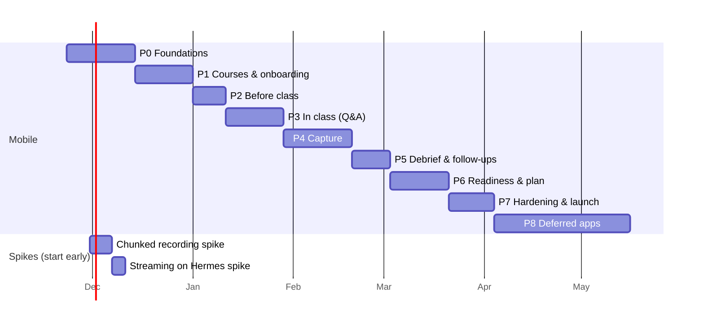

# Zuri mobile: roadmap to 100%

**Date:** 2026-11-16 · **Status:** draft for the mobile and backend teams · **App:** `oladraxler01/Zuri_mobile` `main` `4a272f8`

**Reads with:**
- **Zuri Brain spec:** `docs/product/ZURI_BRAIN_SPEC.md` in `Marvellousik/Backend_zuri_ed` (PR #17)
- **The screen audit:** `docs/SPEC_ALIGNMENT_REPORT.md` (PR #4)
- **The Zuri Mobile design system:** https://claude.ai/artifact/ERJZEJr1gTokiPcXsB7Gfj

This is a plan, not an implementation. Nothing here has been built yet.

---

## 1. What "100%" means

The app is at 100% when all of these are true against the **live** backend (`https://api.zurilearn.com`), on real iOS and Android builds:

| Area | Weight | Done when |
|---|---|---|
| **Student loop (MVP 1)** | 60% | A new student can sign up, onboard, get a reminder, open a class session, ask grounded questions, record and get the lecture filed with notes, take the debrief, see follow-ups, and see exam readiness and a study plan. Every step runs on server data, not on-phone stand-ins. |
| **Foundations** | 10% | One design system with light and dark themes, tests, CI, crash reporting, analytics, OTA updates, and dev/preview/production builds. |
| **Hardening and launch** | 10% | Offline outbox, memory export/delete, accessibility audit passed, performance budgets met, and store listings live (App Store + Play) with privacy labels. |
| **Deferred apps** | 20% | The lecturer app, school admin dashboard and research platform run on real backends instead of sample data (each 6–7%). |

### Where it is today: about 31%

| Area | Today | Score |
|---|---|---|
| Student loop | Screens exist for most stages. Live on the server: sign-in, profile, courses, timetable, Today and stats. Missing or phone-only: class session, chunked capture, transcription, debrief, follow-ups, readiness, plan. | ~22 of 60 |
| Foundations | No tests, lint, CI, crash reporting, analytics or OTA updates. Two competing palettes, no dark theme. `eas.json` has profiles, but `expo-dev-client` isn't installed. | ~3 of 10 |
| Hardening | Local export/delete and per-store offline queues exist. No store release yet. | ~2 of 10 |
| Deferred apps | Screens built on sample or local data; research uses live OpenAlex. | ~4 of 20 |

That's an estimate, weighted by work left. Each phase below adds exactly what's left in its area: Phase 0 the foundations (7), Phases 1–6 the student loop (38), Phase 7 hardening (8) and Phase 8 the deferred apps (16).

---

## 2. Principles for every phase

1. **Ship a loop stage end to end, together with the backend.** Each phase matches a build step in spec §8, and a phase is done only when it works against the live API.
2. **Design system first, then screens.** New and rebuilt screens use only the design system's tokens and components. Old screens move over as they're touched.
3. **Offline-first for anything the student creates.** Save on the phone, show it straight away, sync in the background, never lose it.
4. **Every screen designs four states:** loading (skeletons), empty, error and offline.
5. **Keep the deferred apps working.** Changes to shared stores (`lectures-context`, `materials-context`, `academic-context`) must not break the lecturer, school admin or research screens.
6. **Live test every phase** with a dedicated test student account (see §6), the way the backend connection was checked on 2026-11-16.

---

## 3. Phases

Sizes: **S** ≈ 2–4 dev-days · **M** ≈ 1–2 weeks · **L** ≈ 2–4 weeks, for one mobile developer. Backend markers (✅ / 🟡 / ❌) are the spec's.

### Phase 0: Foundations (L) · +7% → ~38%
*Doesn't depend on the backend. Start now.*

**Theme and design system**
- `src/theme/`: tokens generated from the design system's `tokens.json`, plus `useTheme()`, a `<Text variant>` component, and `<Button>`, `<Card>`, `<ListRow>`, `<Chip>`, `<TextField>`, `<StateView>`, `<BottomSheet>` and `<TabBar>`, as specified in the design system.
- Keep `ZuriColors` and `UI` as aliases that point at the new tokens, so nothing changes visually yet.
- Move screens over one area at a time: onboarding → Home → Courses → lecture → Plan → You → deferred apps. Follow the design system's migration section for the colour, type and radius maps.
- Add a lint rule that forbids hex literals in `src/app/**`, area by area.
- Dark mode behind a setting, turned on once the student loop is migrated.

**Engineering**
- Tests: Jest with `jest-expo` and React Native Testing Library for utilities and contexts. Start with `utils/planner.ts`, `utils/mastery.ts`, `utils/timetable-import.ts` and the `academic-context` sync merge.
- End-to-end: Maestro flows for sign-up → verify → onboarding → Home.
- CI on GitHub Actions: typecheck, lint, unit tests and `expo export` on every PR.
- `expo-dev-client` installed, with EAS builds per profile:
  - development: dev client
  - preview: internal testers, pointing at a staging gateway once one exists
  - production: stores
- `expo-updates` with channels per profile for OTA fixes.
- Sentry (`@sentry/react-native`) for crashes and errors, with no personal data in events.
- Product analytics events for the spec's funnel: onboarded → first class session → first debrief → first readiness view. Use PostHog or the backend's own events; that needs a decision.

**Navigation clean-up**
- Remove `onboarding/admin-sign-in.tsx`. School Board in role select goes to the normal sign-in, and the server role routes the account (backend question: how admin roles are issued).
- Label the deferred apps' sample-data screens as a "Preview".

**Done when:** CI is green on `main`; Sentry receives a test crash from a preview build; onboarding and Home use only tokens and render correctly in both themes; Maestro sign-up flow passes against live.

---

### Phase 1: Courses and onboarding on the server (L) · +6% → ~44%
*Backend spec step 1.*

**Screens**
- `onboarding/student-courses.tsx`: the catalogue sheet loads from the server instead of `constants/course-catalogue.ts`. Personal courses are created with `POST /academic/courses` ❌ instead of the content service.
- `onboarding/institution.tsx`: institution → faculty → department picker from `GET /academic/institutions/{id}/hierarchy` (✅ in the service, **not routed by the gateway**).
- **Rebuild** `onboarding/student-preferences.tsx` as learning preferences:
  - explanation style chips ("Examples first", "Step by step", "Theory first", "Pictures and diagrams"), never "learning style"
  - pace and quiz format
  - hours per day and best study times
  - language and tone
- **New** `onboarding/course-materials.tsx`: notes, slides and past questions per course, via `POST /academic/courses/{id}/materials` ❌.
- `onboarding/complete.tsx`: driven by `GET /academic/onboarding/status` ❌. The whole survey is submitted with `POST /academic/onboarding` ❌.
- Timetable: edit and delete slots with `PUT` / `DELETE /academic/timetable/slots/{id}` ❌. Remove the `hiddenServerIds` workaround.
- `settings/[section].tsx`: a new "Learning preferences" section on `PUT /academic/profile` ❌.

**Data migration**
- On first launch after the update, push phone-only custom courses and their classes to the server: `catalogue: false` courses become academic personal courses, and their `pendingSync` classes are sent.
- Keep phone ids and map them to server ids.
- Answer spec open question 3 (personal → catalogue merge) before shipping.

**Done when:** a brand-new live account with only custom courses sees its real timetable and next class from the server, edits and deletes a class, and changes preferences that survive reinstalling the app.

---

### Phase 2: Before class (M) · +5% → ~49%
*Backend spec step 2.*

**Home**
- Rebuild Home as the Today feed.
- `NextClassCard` hero from `GET /academic/timetable/next` ✅, timezone-correct 🟡.
- Server cards from `GET /academic/today` ✅ with act/dismiss ✅.
- The local `utils/recommendations.ts` stays only as the offline fallback.

**Push**
- Register for push with `expo-notifications` and send the token via `POST /notifications/devices/register` ✅ (routed, unused today).
- The server scheduler 🟡 sends class reminders, with deep links to `upcoming-lecture` / class session.
- Keep the local weekly reminders as a fallback when push permission is denied.

**Other**
- Send the device timezone: either a header or the user record (backend question).
- `upcoming-lecture.tsx` shows pre-loaded context 🟡 (last lecture summary, open gaps) and a "Start class" button within 15 minutes of start.
- Timetable exceptions (cancelled, moved, extra class) via `POST /academic/timetable/exceptions` ❌, shown on Home and in the reminder.

**Done when:** on a real phone, a push arrives 15 minutes before a live timetable class, opens the right screen, and the countdown is right in Africa/Lagos time.

---

### Phase 3: In class, live Q&A (L) · +7% → ~56%
*Backend spec step 3.*

**Streaming client**
- Add to `api-client.ts`: SSE or chunked fetch (format to agree with the backend), with cancellation, retry and token refresh mid-stream.
- Test on Hermes on both platforms.

**New `class/[sessionId].tsx`** (full-screen modal)
- Opens with `POST /academic/class-sessions` ❌.
- Ask box with `AnswerBubble` streaming answers from `/{id}/ask` ❌, with source chips that open the slide or material.
- Flag buttons (didn't get this / important / exam hint) → `/{id}/flags` ❌.
- End class.

**Offline**
- Questions asked offline queue and are answered later; the student sees "Will answer when you're back online".

**Ask outside class**
- Rebuild `ask.tsx` on `partner/chat` ✅ per course, with a course picker. History comes from `partner/history` ✅. Keep the keyword search as the offline fallback.

**Performance:** first token in under 2 s at p95 on a mid-range Android phone over 4G (spec §7). Measure it in the app.

**Done when:** in a live test session, a question about uploaded slides streams a short answer with a correct source chip, and a flag shows up in the session afterwards.

---

### Phase 4: Capture, record and transcribe (L) · +8% → ~64%
*Backend spec step 4. The riskiest phase.*

**Recorder**
- Rebuild `lecture-recording.tsx` as the recording part of the class session (`RecordingBar`).
- Records in 30–60 s chunks with `expo-audio`, by stopping and starting segments or with a native module. Prototype both first and pick the one with no gaps.
- Each chunk is written to `expo-file-system` and uploaded with a sequence number to `POST /academic/class-sessions/{id}/audio` ❌. Uploads are resumable and idempotent, and a chunk is deleted from the phone only after the server acknowledges it.

**Background and consent**
- Recording keeps running with the screen locked (dev/production builds only), with a foreground-service notification on Android.
- Test 2-hour recordings on a low-end Android phone and an iPhone with low battery.
- **New** consent sheet (`BottomSheet`) before the first recording in a session, sent as `recording_consent` ❌.

**After class**
- `/{id}/end` ❌ starts the final transcription and notes job.
- `lecture/[id].tsx` shows the filed lecture (transcript, notes, audio) from the server record ❌.
- Remove the old `/materials` audio upload path and `data/sample-lecture-analysis.ts`.

**Live transcript**
- The class screen shows the latest transcript lines as they arrive (spec target: under 15 s).

**Done when:** a real 2-hour lecture, recorded with the phone locked and the connection dropping twice, arrives complete, is transcribed, and appears in the course with notes within 15 minutes of ending.

---

### Phase 5: Debrief and follow-ups (M) · +5% → ~69%
*Backend spec step 5.*

**New `debrief/[id].tsx`**
- A chat-style guided flow: open → pick topics (pre-selected from flags) → explanation (`AnswerBubble`) → "makes sense / still confused" → quiz of 3–6 questions → recap.
- Driven by `POST /academic/class-sessions/{id}/debrief` ❌ and `POST /academic/debriefs/{id}/reply` ❌.
- Resumable from Home.

**New `follow-ups.tsx`**
- From `GET /academic/follow-ups` ❌; each item opens a short practice set by reusing `study/session.tsx`.
- Shown on Home and in the Study hub.

**Signals and mastery**
- Every quiz and flashcard answer in `study/session.tsx` and the lecture Questions tab also goes to `POST /academic/learning-signals` ✅.
- Course Topics and `study/mastery.tsx` switch from local `utils/mastery.ts` to `knowledge-state` ✅ / `weak-topics` ✅. Local mastery stays only offline.

**Notifications:** "Debrief ready" and "Follow-up due" pushes, with deep links.

**Done when:** after a live class session, the debrief runs end to end. A wrong answer creates a follow-up that shows on Home the next day, and the topic's mastery changes on the course page.

---

### Phase 6: Readiness, exams and study plan (L) · +7% → ~76%
*Backend spec step 6.*

**Exams**
- Rebuild `assessment/edit.tsx` and `assessment/[id].tsx` so exams go to `POST /academic/exams` ❌.
- Assignments and projects stay phone-only (app-only, per the audit).

**Readiness**
- **New** `readiness.tsx` (overall, `GET /academic/readiness` ❌) and course readiness (`GET /academic/courses/{id}/readiness` ❌) with `ReadinessRing`, coverage, the "costs you the most marks" list and hours needed.

**Plan**
- Rebuild the Plan tab on `GET /academic/study-plan` ❌: a day-by-day plan to each exam that re-plans when the student falls behind.
- The local `utils/planner.ts` stays the offline fallback.

**Diagnostic and past questions**
- **New** `diagnostic/[courseId].tsx`, optional in onboarding and from the course page, seeding the knowledge state ❌.
- The past-questions upload from Phase 1 now drives topic weights ❌.

**Analytics:** readiness trend ("41% → 67%"), study time and streaks from the analytics service ✅ in `profile/learning.tsx` and `study/history.tsx`.

**Done when:** a test student with an exam date and two debriefs sees a readiness score, hours needed and a plan, and the score moves after a practice session.

---

### Phase 7: Hardening and launch (M) · +8% → ~84%
*Backend spec step 7.*

**Data and offline**
- Memory export and delete on the server: `GET /academic/me/export` ❌ and `DELETE /academic/me` ❌ from Settings → Privacy, replacing the local-only export.
- One shared offline outbox for every write, using client event ids (sync service 🟡), replacing the per-store queues.

**Voice**
- Hold-to-talk questions (server STT) and read-aloud explanations (AI service TTS ✅ or `expo-speech`).

**Quality**
- Accessibility audit with VoiceOver and TalkBack on the loop screens: labels, order, 1.3× font scaling, contrast in both themes.
- Performance budgets: cold start under 2.5 s on a mid-range Android phone, Home interactive under 1 s from cache, no dropped frames on lists.

**Store launch**
- App Store and Play listings, privacy labels (microphone, audio retention, analytics), a review account, TestFlight / Play internal beta with 20–50 students at one university, then a staged rollout.
- Crash-free sessions at least 99.5% over the beta before full release.

**Done when:** the store builds are approved, the beta funnel shows students completing the loop, and export/delete is tested end to end.

---

### Phase 8: Deferred apps on real backends (L each) · +16% → 100%
*After MVP 1. Backend scope still to be specced.*

**Lecturer app** (`lecturer/*`, `teach/*`, `onboarding/lecturer-setup.tsx`, the lecture Class tab)
- Lecturer accounts and course ownership on the server.
- Class insights from `GET /academic/courses/{id}/lecturer-signals` ✅ (aggregate, no personal data) instead of `data/sample-class-insights.ts`.
- Quizzes, revision packs and announcements stored on the server.

**School admin dashboard** (`institution/*`, `admin/*`)
- Institution admin role.
- Hierarchy, offerings and enrolment routed by the gateway (they aren't today).
- Timetable management, staff and roles, and analytics from real data instead of `data/sample-institution.ts`.

**Research platform** (Research tab, `scholar/*`)
- Projects and saved papers synced to the server.
- AI synthesis and project chat on the server, replacing the quotes-only answers.

**Done when:** each app works with a real account of its role, and the "Preview" labels are gone.

---

## 4. Order and parallel work

The dates assume one mobile developer, and the timeline only holds if the backend is a step ahead. The two spikes start during Phase 0, because they're the biggest technical unknowns (Phases 3–4).

**What can run in parallel:**
- **Design-system migration** of existing screens runs alongside Phases 1–3. It touches screen styles, while the phases touch data and new screens.
- **A second developer:** Phase 8's lecturer app can start once Phase 1's personal courses and role routing land.

---

## 5. Client capabilities to add

| Capability | Phase | Library | Status today |
|---|---|---|---|
| Theme + dark mode | 0 | `useColorScheme`, `src/theme/` | ❌ |
| Tests / E2E / CI | 0 | `jest-expo`, RN Testing Library, Maestro, GitHub Actions | ❌ |
| Crash reporting | 0 | `@sentry/react-native` | ❌ |
| OTA updates | 0 | `expo-updates` | ❌ |
| Dev builds | 0 | `expo-dev-client` | profile only |
| Haptics | 0 | `expo-haptics` | ❌ |
| Push | 2 | `expo-notifications` (remote) | local only |
| Streaming | 3 | `fetch` streams / `react-native-sse` | ❌ |
| Chunked + background recording | 4 | `expo-audio` (+ native module if needed), `expo-file-system` | single file only |
| Camera for past papers | 1 | `expo-image-picker` | ❌ |
| Shared offline outbox | 7 | `@react-native-community/netinfo` + client event ids | per-store queues |
| Voice in / out | 7 | server STT, AI TTS or `expo-speech` | ❌ |

---

## 6. How each phase is tested

- **Unit:** pure logic and context merges, run in CI.
- **E2E:** one Maestro flow per loop stage, against the live API with a dedicated test student. The account is created as on 2026-11-16 (`+zuritest` address), and its credentials are kept out of the repo, as an EAS secret.
- **Live check script:** extend the 2026-11-16 route check (every route the app calls, signed in) to each new endpoint, and run it before every release.
- **Device matrix:** one low-end Android phone (2–3 GB RAM), one recent Android phone, one iPhone. Recording tests always run on the low-end Android phone.
- **Beta metrics:** the funnel from §3 Phase 0, crash-free sessions, first-token latency, and upload completion rate.

---

## 7. Risks

| Risk | Phase | Mitigation |
|---|---|---|
| Chunked background recording loses audio or drains the battery | 4 | Spike early; local copy kept until acknowledged; low-end device test; a fallback to whole-file upload |
| Streaming doesn't work reliably on Hermes | 3 | Spike early; fall back to polling partial answers |
| Backend endpoints land late (most are ❌) | 1–6 | Build screens against agreed request/response contracts and mock servers; ship behind feature flags |
| Personal → catalogue course merge corrupts student data | 1 | Agree on the merge rules (spec Q3) before the migration; dry-run on test accounts |
| Design-system migration causes visual regressions | 0+ | Alias-first rollout; screenshot checks per area |
| Lecturer/admin apps break when shared stores change | all | Keep their tests in CI; label them as previews; no shared-store change without running their flows |
| No staging backend: every test hits production | all | Ask the backend for a staging gateway (their Phase 0); until then, dedicated test accounts only |

---

## 8. Decisions needed

1. **Analytics tool:** PostHog, or the backend's own event pipeline?
2. **Staging environment:** will the backend provide a staging gateway for preview builds?
3. **Streaming format and audio chunk format:** see the alignment report's open questions 5–6.
4. **Admin and lecturer account creation:** how do they get their role (alignment report question 10)?
5. **Dark mode at launch** or right after it? The plan assumes it ships with Phase 7.
6. **Team size:** with two mobile developers, Phase 8 can start in parallel with Phase 3.
