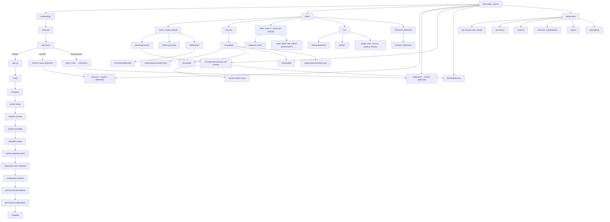

# Zuri mobile ↔ Zuri Brain spec: alignment report

**Date:** 2026-11-16
**App audited:** `oladraxler01/Zuri_mobile` at `main` `4a272f8`
**Spec:** `docs/product/ZURI_BRAIN_SPEC.md` (Draft 2026-11-16), backend repo `Marvellousik/Backend_zuri_ed`, PR #17

**How this was produced:**
- Read every file under `src/app/` (89 route files), the contexts in `src/context/`, the services in `src/services/`, `app.json`, `package.json` and `PROGRESS.md`.
- Checked the gateway route table in `services/gateway/internal/handler/gateway_handler.go` (backend `main`).
- Earlier the same day, every server route the app calls was checked live against `https://api.zurilearn.com` with a signed-in test student (see `PROGRESS.md`, "Live check of every server call").
- **The app was not run on a simulator for this audit.** "State" below is taken from code and the phase log. Where that matters it says *unverified*.

Status markers (✅ / 🟡 / ❌) are the spec's own, from §3 and §6. "app-only" means the app has it and the spec doesn't mention it.

Buckets: **Keep**, **Rebuild**, **Build new** and **Scrap** are as defined in the audit brief. **Defer** is added for screens that stay in the app as upcoming features but sit outside the MVP 1 student loop (spec §9): the lecturer app, the school admin dashboard and the research platform. Deferred screens get no MVP work and aren't removed.

---

## 1. Summary

| Bucket | Count | What's in it |
|---|---|---|
| **Keep** | 42 | Student onboarding (incl. role select), Courses, You, lectures, materials, notifications, study, settings, system screens |
| **Rebuild** | 7 | Home (Today), Plan, Ask, assessment detail/edit (→ exams), lecture recording (→ class capture), learning preferences step |
| **Build new** | 8 | Course materials + past questions (onboarding), diagnostic quiz, recording consent, live class session, debrief, follow-ups, readiness overview, course readiness |
| **Defer** | 39 | Lecturer app (13) + lecturer setup, school admin dashboard (13), research platform (12): upcoming features, outside the MVP 1 loop |
| **Scrap** | 1 | Admin sign-in (`onboarding/admin-sign-in.tsx`) |

**Biggest risks:**
1. **Almost all the "brain" is on the phone today.** The server is reached only for sign-in, profile, academic sync (courses/timetable/today/stats) and file uploads. Ask, the Today feed, mastery, study sessions, quizzes, the study plan and lecture "analysis" are all computed locally from on-phone data. Moving each of these to the server (spec §6) is most of the mobile work, and most of those endpoints are ❌.
2. **Lecture capture can't do what the spec needs.** `lecture-recording.tsx` records one file and uploads it after class as a content-service *material* (`POST /materials`). It has no chunks, no class session, no consent, and no live transcript. The server never finishes processing those uploads: `processing_status` stays `pending`, so lectures show "Processing" forever. Stage 3 and 4 depend on ❌ endpoints *and* a new chunked recorder in the app.
3. **Personal courses are phone-only.** The live catalogue is empty, so every course a student adds is a custom content-service course, and its classes never reach the academic service. Until `POST /academic/courses` (❌, spec step 1) lands, the timetable, next class, reminders, tutor and mastery can't work server-side for real students.
4. **No streaming client.** The spec's in-class answers stream token by token (first token < 2 s). The app's `api-client.ts` only does request/response JSON; nothing in the app reads SSE or chunked responses yet.
5. **Deferred apps run on sample data.** The lecturer app, school admin dashboard and most of the research tools use local or sample data (`data/sample-class-insights.ts`, `data/sample-institution.ts`). Users who pick Lecturer or School Board see figures that aren't real. Label them "preview" until their backends exist.
6. **Two sources of mastery.** The app computes mastery locally (`utils/mastery.ts`, `progress-context`), while the spec makes the academic knowledge state the owner (§6 rules). Course pages, study and readiness must switch to `knowledge-state` / readiness endpoints, or the numbers students see will disagree.

---

## 2. Screen inventory

Paths are relative to `src/app/`. "Calls" lists the server routes a screen reaches, directly or through its context. "local" means it reads phone-only data.

Contexts that call the server:
- `academic-context`: academic sync, see `services/academic-api.ts`
- `session-context`: auth
- `lectures-context` and `materials-context`: uploads, via `services/upload-api.ts`

Every other context is local only.

### Student app

| Screen | Path | Today | Calls | State | Bucket | Spec stage | Notes |
|---|---|---|---|---|---|---|---|
| Tab bar | `(tabs)/_layout.tsx` | Home · Courses · Plan · Research · You | — | working | Keep | — | All tabs stay; Research is a deferred feature |
| Home | `(tabs)/index.tsx` | Greeting, next class, recommendation, deadline/exam cards, get-started checklist, shortcuts | local (`feed-context` from `utils/recommendations.ts`); next class from synced timetable | working (local) | **Rebuild** | 2, 5, 6 | Must become the server Today feed |
| Courses | `(tabs)/explore.tsx` | Course list, add/remove course | `academic-context` (enrol ✅ / `POST /courses`) | working | Keep | 1 | Switch custom-course create to `POST /academic/courses` ❌ |
| Plan | `(tabs)/plan.tsx` | This week / Deadlines / Calendar; local study-plan builder | local (`planner-context`, `utils/planner.ts`) | working (local) | **Rebuild** | 7 | Becomes exams + server study plan |
| Research | `(tabs)/research.tsx` | Research home (OpenAlex) | OpenAlex (external) | working | Defer | — | Upcoming research platform (§9) |
| You | `(tabs)/you.tsx` | Profile hub, stats, settings links | local stats | working | Keep | 6, 7 | Stats later from analytics ✅ |
| Root stack | `_layout.tsx` | Providers, startup gate, stack | `GET /users/me` via session | working | Keep | — | Role stacks (lecturer, institution) stay |
| Entry | `index.tsx` | Routes by role / onboarding | — | working | Keep | 1 | Keeps routing by role |
| Not found | `+not-found.tsx` | Branded 404 | — | working | Keep | — | |
| Ask Zuri | `ask.tsx` | Keyword search over transcripts/passages, answers are quote cards | local (`utils/source-search.ts`) | working (no AI) | **Rebuild** | 3, 5 | Becomes course tutor on partner chat ✅ / class-session ask ❌ |
| Ask history | `ask-history.tsx` | Saved conversations, star, delete | local (`conversations-context`) | working | Keep | 6 | Load `partner/history` ✅ per course |
| Assessment detail | `assessment/[id].tsx` | Countdown, checklist, study sessions, topics, related lectures | local (`planner-context`) | working (local) | **Rebuild** | 7 | Exams → readiness; assignments are app-only |
| Assessment edit | `assessment/edit.tsx` | Add/edit assignment/test/exam/project | local | working (local) | **Rebuild** | 7 | Exams → `POST /academic/exams` ❌ |
| Course detail | `course/[id].tsx` | Overview, Schedule, Lectures, Materials, Assessments, Topics, Activity | synced course/timetable; mastery local | working | Keep | 1, 2, 6, 7 | Topics → `knowledge-state` ✅; add readiness card |
| Lecture detail | `lecture/[id].tsx` | Overview, Transcript (audio-synced), Notes, Questions, Class (lecturer) | upload status; analysis from upload result or sample | partial (server never finishes) | Keep | 4, 6 | Already the spec's lecture detail; feed from filed lecture ❌; Class tab (lecturers) is deferred |
| Lecture archive | `lectures.tsx` | Search + course filter | local | working | Keep | 4, 6 | |
| Record lecture | `lecture-recording.tsx` | Single-file recorder, pause/resume, course picker, save & upload | `POST /materials` → presign → PUT → poll | partial | **Rebuild** | 3, 4 | Becomes the capture part of the class session |
| Material detail | `material/[id].tsx` | Open, share, summary/concepts/quiz/passages | upload result or on-phone text analysis | partial | Keep | 1, 4 | |
| Add material | `material/new.tsx` | Pick file, course, type, visibility, upload | `POST /materials` ✅ (content) | working (processing pending) | Keep | 1 | Add "past questions" type; target `POST /academic/courses/{id}/materials` ❌ |
| Materials | `materials.tsx` | Library, search, filters, pin | local list | working | Keep | 1 | |
| Notifications | `notifications.tsx` | Notification centre from local feed | local | working (local) | Keep | 2, 5 | Source becomes Today + follow-ups |
| Recommendation | `recommendation/[id].tsx` | Why / what to do / snooze / dismiss | local | working (local) | Keep | 2 | Server cards → act/dismiss ✅ |
| Global search | `search.tsx` | Search across courses, deadlines, lectures, materials | local | working | Keep | — | app-only, harmless |
| Settings | `settings/[section].tsx` | study, notifications, recording, ai, university, privacy (export/delete), account, help | local; notification prefs `PUT /notifications/preferences` ✅ | working | Keep | 1, 6 | Privacy → server export/delete ❌ |
| Status screens | `status/[kind].tsx` | session-expired / update-required / maintenance | — | working | Keep | — | |
| Study hub | `study/index.tsx` | Start session, weak topics, per course | local | working (local) | Keep | 5, 6 | Add follow-ups due |
| Study session | `study/session.tsx` | Local quiz/flashcards from lecture analysis, "Explain it" | local | working (local) | Keep | 5, 6 | Send each answer as learning signal ✅ |
| Mastery | `study/mastery.tsx` | All-course mastery | local | working (local) | Keep | 6 | → `knowledge-state` ✅ |
| Study history | `study/history.tsx` | Minutes chart, streak, accuracy | local | working (local) | Keep | 7 | → analytics ✅ |
| Upcoming class | `upcoming-lecture.tsx` | Countdown, venue, prep from last lecture | synced timetable; local prep | working | Keep | 2 | Add "I'm in class"; prep → pre-loaded context 🟡 |
| Academic profile | `profile/academic.tsx` | Name, matric, faculty, dept, level, semester | local | working (local) | Keep | 1 | Save to `PUT /academic/profile` ❌ / users ✅ |
| Goals | `profile/goals.tsx` | Target result, weekly hours, goals | local | working (local) | Keep | 1, 7 | Hours/day → profile ❌ |
| Knowledge / data | `profile/knowledge.tsx` | What Zuri stores, clear history | local | working (local) | Keep | 6 | Server export/delete ❌ |
| Learning profile | `profile/learning.tsx` | Strengths, growth areas, accuracy, habits | local | working (local) | Keep | 7 | Analytics view → server ✅/❌ |
| Microphone permission | `permissions/microphone.tsx` | Onboarding step | — | working | Keep | 1, 4 | Pair with consent (new) |
| Notification permission | `permissions/notifications.tsx` | Onboarding step; local reminders | — | working | Keep | 2 | Add push token registration ✅ |

### Student onboarding

| Screen | Path | Today | Calls | State | Bucket | Spec stage | Notes |
|---|---|---|---|---|---|---|---|
| Onboarding stack | `onboarding/_layout.tsx` | Stack | — | working | Keep | 1 | |
| Splash | `onboarding/index.tsx` | Animated ZURI splash | — | working | Keep | 1 | |
| Welcome | `onboarding/welcome.tsx` | Sign up / sign in / admin link | — | working | Keep | 1 | Admin link → sign in (admin sign-in is scrapped) |
| Sign up | `onboarding/sign-up.tsx` | Name, email, password | `POST /auth/register` ✅ | working (live-checked) | Keep | 1 | |
| Verify | `onboarding/verify.tsx` | 6-digit email code | `POST /auth/verify-email` ✅, resend ✅, login ✅ | working (live-checked) | Keep | 1 | |
| Sign in | `onboarding/sign-in.tsx` | Email + password | `POST /auth/login` ✅ | working (live-checked) | Keep | 1 | |
| Institution | `onboarding/institution.tsx` | University picker (`constants/nigerian-universities.ts`) | local | working (local) | Keep | 1 | Hierarchy route not on gateway (see §10) |
| Profile setup | `onboarding/profile-setup.tsx` | Name, matric, faculty | local | working (local) | Keep | 1 | Fold into `POST /academic/onboarding` ❌ |
| Courses | `onboarding/student-courses.tsx` | Add courses; sample catalogue sheet (`constants/course-catalogue.ts`) | enrol ✅ → fallback `POST /courses` | working | Keep | 1 | Catalogue from server; personal → `POST /academic/courses` ❌ |
| Timetable | `onboarding/student-timetable.tsx` | Manual slots + CSV/text import | `POST /academic/timetable/slots` ✅ (catalogue courses only) | working | Keep | 1, 2 | Slots for personal courses need step 1 |
| Timetable review | `onboarding/timetable-review.tsx` | By day, clash detection | local | working | Keep | 1 | |
| Preferences | `onboarding/student-preferences.tsx` | Target GPA, weekly hours, reminders | `PUT /notifications/preferences` ✅ | working | **Rebuild** | 1 | Missing learning style, pace, quiz format, windows, language |
| Complete | `onboarding/complete.tsx` | Summary of what's set up | local | working | Keep | 1 | Read `GET /academic/onboarding/status` ❌ |
| Role select | `onboarding/role-select.tsx` | Student / Lecturer / School Board | — | working | Keep | 1 | Needed: sends each role to its own app. School Board → normal sign-in instead of admin sign-in |
| Lecturer setup | `onboarding/lecturer-setup.tsx` | Lecturer profile + courses | local | working (local) | Defer | — | Part of the lecturer app |
| Admin sign-in | `onboarding/admin-sign-in.tsx` | Institution email + access code, format check only | local | working (local, no real check) | Scrap | — | School admins use the normal sign-in; their server role routes them to `/institution` |

### Lecturer app (all Defer: upcoming, outside the MVP 1 loop per §9)

| Screen | Path | Today | Calls | State | Bucket |
|---|---|---|---|---|---|
| Lecturer tabs | `lecturer/_layout.tsx` | Today · Courses · Insights · Tools · Profile | — | working | Defer |
| Today | `lecturer/index.tsx` | Next lecture, alerts, signals | local + sample | working (sample) | Defer |
| Courses | `lecturer/courses.tsx` | Courses taught | local | working (local) | Defer |
| Insights | `lecturer/insights.tsx` | Engagement, mastery, misconceptions | `data/sample-class-insights.ts` | placeholder data | Defer |
| Profile | `lecturer/profile.tsx` | Verification status | local | working (local) | Defer |
| Tools | `lecturer/tools.tsx` | Tool list | local | working (local) | Defer |
| Teach stack | `teach/_layout.tsx` | Stack | — | working | Defer |
| Course | `teach/course/[id].tsx` | Course page | local | working (local) | Defer |
| Announcement | `teach/announcement.tsx` | Compose + history | local | working (local) | Defer |
| Assessment | `teach/assessment.tsx` | Create assessment | local | working (local) | Defer |
| New quiz | `teach/quiz/new.tsx` | Quiz generator | local | working (local) | Defer |
| Quiz | `teach/quiz/[id].tsx` | Review / publish | local | working (local) | Defer |
| Revision pack | `teach/revision/[id].tsx` | Pack builder | local | working (local) | Defer |

### School admin dashboard (all Defer: upcoming, outside the MVP 1 loop per §9)

| Screen | Path | Today | Calls | State | Bucket |
|---|---|---|---|---|---|
| Institution tabs | `institution/_layout.tsx` | Overview · Academics · Analytics · Settings | — | working | Defer |
| Overview | `institution/index.tsx` | KPIs | `data/sample-institution.ts` | placeholder data | Defer |
| Academics | `institution/academics.tsx` | Structure, timetable, library | sample + local | placeholder data | Defer |
| Analytics | `institution/analytics.tsx` | Learning/engagement/cost | sample | placeholder data | Defer |
| Settings hub | `institution/settings.tsx` | Settings links | local | working (local) | Defer |
| Admin stack | `admin/_layout.tsx` | Stack | — | working | Defer |
| Course | `admin/course/[id].tsx` | Enrolment, timetable editor | sample | placeholder data | Defer |
| Faculty | `admin/faculty/[id].tsx` | Faculty view | sample | placeholder data | Defer |
| Intelligence | `admin/intelligence.tsx` | University-wide trends | sample | placeholder data | Defer |
| Lecturers | `admin/lecturers.tsx` | Directory | local | placeholder data | Defer |
| Students | `admin/students.tsx` | Directory | sample | placeholder data | Defer |
| Research | `admin/research.tsx` | Institution papers | OpenAlex | working | Defer |
| Settings | `admin/settings/[section].tsx` | Roles, staff, audit, API keys | sample | placeholder data | Defer |

### Research platform (all Defer: upcoming, outside the MVP 1 loop per §9)

| Screen | Path | Bucket |
|---|---|---|
| Library | `scholar/library.tsx` | Defer |
| Search | `scholar/search.tsx` | Defer |
| Paper | `scholar/paper/[id].tsx` | Defer |
| New project | `scholar/project/new.tsx` | Defer |
| Project | `scholar/project/[id]/index.tsx` | Defer |
| Project chat | `scholar/project/[id]/chat.tsx` | Defer |
| Citations | `scholar/project/[id]/citations.tsx` | Defer |
| Compare | `scholar/project/[id]/compare.tsx` | Defer |
| Map | `scholar/project/[id]/map.tsx` | Defer |
| Settings | `scholar/project/[id]/settings.tsx` | Defer |
| Synthesis | `scholar/project/[id]/synthesis.tsx` | Defer |

All research screens work against OpenAlex (`services/scholar-api.ts`) with `research-context`. Together with `(tabs)/research.tsx` that's 12 research screens.

---

## 3. Rebuild details

### Home → Today (`(tabs)/index.tsx`)
**What's wrong:**
- The feed is built on the phone by `utils/recommendations.ts`, from local lectures, materials and the planner.
- Server Today cards (`todayTimeline`, already synced by `academic-context`) and follow-ups aren't shown.
- The next class uses the synced timetable but computes the countdown on the phone. That's fine, but the server's `next` is in server local time (spec §3 stage 2).

**What it becomes:** the Today feed from the spec:
- next class countdown, with a "Start class" button when within the window
- today's classes
- follow-ups due
- debrief pending
- suggested reviews
- exam countdowns

Server cards drive it. The local recommendations stay only as an offline fallback.

**Endpoints:**
- ✅ `GET /academic/today`, act/dismiss
- ✅ `GET /academic/timetable/next` (🟡 timezone)
- ❌ `GET /academic/follow-ups`
- ❌ `POST /academic/class-sessions` (for the start button)

### Plan (`(tabs)/plan.tsx`)
**What's wrong:**
- Deadlines, exams and the study plan live in `planner-context`.
- On first launch the planner seeds sample entries and a sample academic calendar.
- `utils/planner.ts` spreads sessions before each deadline. It isn't based on mastery or readiness.

**What it becomes:** an exam-driven plan:
- the exams list
- the server's day-by-day study plan (`GET /academic/study-plan`), re-planned by the server
- "~14 h to be exam-ready" per course

Assignments/projects can stay as a local, app-only list (the spec has no assignments).

**Endpoints:**
- ❌ `GET /academic/study-plan`
- ❌ `POST /academic/exams`
- ❌ `GET /academic/readiness`

### Ask Zuri (`ask.tsx`)
**What's wrong:** answers are keyword matches from `utils/source-search.ts`, with no AI. It isn't tied to a course session or a lecture. The footnote already says "AI-written answers arrive when the backend is connected".

**What it becomes:**
- **Outside class:** the course tutor, on `POST /academic/courses/{id}/partner/chat`, with history. It needs a course picker, cited sources and voice in/out.
- **In class:** the class session screen (Build new) takes over.

**Endpoints:**
- ✅ `partner/chat` and `partner/history` (not streaming, and live-checked 404 for personal courses)
- 🟡 citations (§3 stage 3)
- ✅ AI stream exists, but partner chat doesn't use it

### Assessment detail / edit (`assessment/[id].tsx`, `assessment/edit.tsx`)
**What's wrong:** these are local planner items (assignment / test / exam / project). The server has no student exam endpoint: `AcademicEvent` is 🟡 with no route.

**What it becomes:**
- **Exam detail:** date, readiness score, coverage, the "costs you the most marks" gap list, hours needed, plan to the exam.
- **Exam edit:** writes to the server.

Assignments/projects stay local (app-only).

**Endpoints:**
- ❌ `POST /academic/exams`
- ❌ `GET /academic/courses/{id}/readiness`

### Record lecture → class capture (`lecture-recording.tsx`)
**What's wrong:**
- It records one file (`expo-audio`, 16 kHz mono AAC) and uploads it after stopping, as a content material (`services/upload-api.ts`).
- It has no class session, chunks or consent, and no live transcript.
- Server processing never completes, so lecture detail shows sample or "Processing".
- `app.json` enables background recording, but that only works in a dev/store build.

**What it becomes:**
- The recording part of the live class session.
- It records in 30–60 s chunks, uploads each with `seq` (resumable, idempotent) and keeps a local copy until acknowledged.
- It shows live-transcript status and needs consent first.
- On end, it calls `/end` and the lecture appears in the course when the notes job finishes.
- It can stay reachable on its own ("record without asking") as a class session with no questions.

**Endpoints:**
- ❌ `POST /academic/class-sessions`
- ❌ `POST /academic/class-sessions/{id}/audio`
- ❌ `POST /academic/class-sessions/{id}/end`
- 🟡 STT
- ✅ `/ai/jobs`

### Learning preferences (`onboarding/student-preferences.tsx`)
**What's wrong:** it asks for target GPA, weekly study hours and reminder settings only. Elsewhere (`academic-context` → `StudentPreferences`) it keeps `preferredStudyTime`, `aiAnswerStyle` and `sessionSize`. None of this is stored on the server.

**What it becomes:** the spec's learning-preferences step:
- explanation style (examples-first / theory-first / visual / step-by-step)
- pace
- quiz format
- study hours per day
- best study windows
- language and tone
- reminder lead time

It is submitted as part of `POST /academic/onboarding` and edited later via `PUT /academic/profile`, with a matching "Learning preferences" section in `settings/[section].tsx`.

**Endpoints:**
- ❌ `POST /academic/onboarding`
- ❌ `PUT /academic/profile`
- ✅ `PUT /notifications/preferences`

---

## 4. Build new

### 4.1 Course materials & past questions (onboarding step, e.g. `onboarding/course-materials.tsx`)
- **Purpose:** after courses and timetable, attach notes, slides, textbooks and **past questions** per course (Stage 1.4).
- **UI:**
  - per-course list with "Add notes / slides / past questions"
  - file picker (`expo-document-picker`, already installed) and camera for photos of past papers (*new dependency*)
  - per-file upload progress
  - a "skip for now" option
- **States:**
  - loading: uploading per file
  - empty: "No files yet. You can add them later from the course page."
  - error: per-file retry
  - offline: files queue the way materials already do (`materials-context` offline queue)
- **Endpoints:**
  - ❌ `POST /academic/courses/{id}/materials` (→ ingestion job; past questions parsed by topic/year)
  - ✅ presigned upload path exists for content materials
- **Spec build step:** 1 (attach) and 6 (past-question parsing → topic weights)

### 4.2 Diagnostic quiz (`diagnostic/[courseId].tsx`, optional onboarding step + from course page)
- **Purpose:** a short quiz per course that seeds the knowledge state (Stage 1.5).
- **UI:**
  - intro ("5 questions, ~3 min")
  - one question at a time
  - confidence slider
  - result: topics marked strong / weak / not seen
- **States:**
  - loading: generating the quiz
  - empty: no syllabus/material yet → "Add materials first"
  - error: retry
  - offline: not available, show a message
- **Endpoints:**
  - 🟡 tutor `DIAGNOSTIC_QUIZ` intent via `partner/chat`
  - ✅ `POST /academic/learning-signals` (`signal_type: 'diagnostic'`)
  - ❌ a "seed diagnostic" flow that writes the first knowledge state
- **Spec build step:** 1 (seeding), usable after 5

### 4.3 Recording consent (sheet, e.g. `components/class/consent-sheet.tsx`)
- **Purpose:** capture consent per class session before recording (Stage 4.7). Show the institution/lecturer policy when known.
- **UI:**
  - who can hear it (private by default)
  - retention period
  - "I have permission to record this class" toggle
  - Continue / Record without saving audio
- **States:**
  - loading: fetching policy
  - error: fall back to the default text
  - offline: allowed; consent is sent with the session when back online
- **Endpoints:**
  - ❌ `recording_consent` on `POST /academic/class-sessions`
  - ❌ institution settings
- **Spec build step:** 4

### 4.4 Live class session (`class/[sessionId].tsx`)
- **Purpose:** the in-class screen (Stage 3 + 4).
- **UI:**
  - course and lecture header
  - elapsed time and recording indicator (chunk upload health)
  - live transcript tail
  - ask box (type or voice) with **streamed** short answers and source chips (slide 12 / transcript 10:42 / notes p.3)
  - three flag buttons: didn't get this / important / exam hint
  - End class
- **States:**
  - loading: opening session
  - empty: no transcript yet ("Listening…")
  - error: answer failed → retry; chunk failed → shows queued count
  - offline: questions queued and answered later; audio chunks stored and uploaded in order
- **Endpoints:**
  - ❌ `POST /academic/class-sessions`
  - ❌ `/{id}/ask` (streamed)
  - ❌ `/{id}/flags`
  - ❌ `/{id}/audio`
  - ❌ `/{id}/end`
  - ✅ AI stream exists underneath
- **Spec build step:** 3 (session, ask, flags), 4 (audio, transcript)

### 4.5 Debrief (`debrief/[id].tsx`)
- **Purpose:** the post-class conversation: open → explain → quiz → recap (Stage 5).
- **UI:**
  - chat-style thread with step indicator
  - topic chips (pre-selected from the student's flags)
  - explanation cards with "makes sense / still confused"
  - inline quiz (3–6 questions)
  - recap card: solid / needs work / next follow-up dates
  - resumable
- **States:**
  - loading: tutor thinking
  - empty: no lecture filed yet → "Your notes are still being prepared"
  - error: retry the turn
  - offline: resume later (state is server-side)
- **Endpoints:**
  - ❌ `POST /academic/class-sessions/{id}/debrief`
  - ❌ `POST /academic/debriefs/{id}/reply`
  - ✅ learning signals
- **Spec build step:** 5

### 4.6 Follow-ups (`follow-ups.tsx`)
- **Purpose:** spaced-repetition follow-ups due, from debrief failures (Stage 5.4 / 6). Also a section on Home and the Study hub.
- **UI:**
  - due today / overdue / upcoming
  - each item opens a short practice set (reuse `study/session.tsx`)
  - completion moves it to the next interval
- **States:**
  - loading: skeleton list
  - empty: "Nothing due, you're on top of it"
  - error: retry
  - offline: show the cached list; completions queued
- **Endpoints:**
  - ❌ `GET /academic/follow-ups`
  - ✅ learning signals for answers
- **Spec build step:** 5

### 4.7 Readiness overview (`readiness.tsx`)
- **Purpose:** exam readiness across courses (Stage 7).
- **UI:**
  - per course: readiness %, coverage, hours needed and exam date
  - trend ("41% → 67%")
  - total hours to be exam-ready
  - link to the plan
- **States:**
  - loading: skeleton
  - empty: no exams → "Add your exam dates"
  - error: retry
  - offline: last cached values with a timestamp
- **Endpoints:**
  - ❌ `GET /academic/readiness`
  - ✅ analytics for streak/time
- **Spec build step:** 6

### 4.8 Course readiness (`readiness/[courseId].tsx`, or a Readiness tab on `course/[id].tsx`)
- **Purpose:** one course's readiness score, coverage, the "costs you the most marks" ranked gap list, hours needed and the plan to its exam.
- **UI:**
  - score ring
  - coverage bar
  - ranked topic list with mastery and weight, each with "practise now"
  - hours
  - exam countdown
- **States:**
  - loading
  - empty: no syllabus → "Add materials or past questions"
  - error
  - offline: cached
- **Endpoints:**
  - ❌ `GET /academic/courses/{id}/readiness`
  - ✅ `knowledge-state`, `weak-topics` (live-checked: 404 for personal courses)
- **Spec build step:** 6

**Already in the app, so not new:**
- **Lecture detail:** `lecture/[id].tsx` has transcript, notes, audio and questions. It needs a server lecture record (spec step 4).
- **Memory export/delete:** export and delete exist locally in `settings/[section].tsx` (privacy) and `profile/knowledge.tsx`. They need the server routes, `GET /academic/me/export` ❌ and `DELETE /academic/me` ❌ (spec step 7).

---

## 5. Scrap and deferred lists

### Scrap

| Screen | Why | Replacement | Navigation clean-up |
|---|---|---|---|
| `onboarding/admin-sign-in.tsx` | It checks the institution email and access code only for format, on the phone, so anyone can get in. The server has no admin access-code route. | The normal sign-in (`onboarding/sign-in.tsx`). The server's user `role` sends an institution admin to `/institution` through `ROLE_HOME` in `session-context`. | Role select "School Board" and the Welcome link ("Institution admin? Sign in here") go to `/onboarding/sign-in`; remove the `admin-sign-in` route. |

**Depends on the backend:** the server must be able to create institution-admin accounts with a role the app maps to `institution` (see §10).

### Defer (stays in the app, no MVP 1 work)

| Feature | Screens | Today | What it needs later |
|---|---|---|---|
| Lecturer app | `lecturer/*` (6), `teach/*` (7), `onboarding/lecturer-setup.tsx`; Class tab in `lecture/[id].tsx` | Local data plus `data/sample-class-insights.ts` | Lecturer accounts and course ownership on the server; the academic service's lecturer signals (`GET /academic/courses/{id}/lecturer-signals`, already routed by the gateway) |
| School admin dashboard | `institution/*` (5), `admin/*` (8) | `data/sample-institution.ts` and local edits | Institution admin role and APIs: hierarchy, offerings and cohort enrolment exist in the academic service but aren't routed by the gateway; timetable management has no admin routes |
| Research platform | `(tabs)/research.tsx`, `scholar/*` (11) | Live OpenAlex search, projects saved on the phone | AI synthesis and chat on the server; saved projects synced |

**Guardrails while deferred:**
- Keep `role-select.tsx` as the entry for all three roles.
- Label sample-data screens as a preview, so lecturers and admins don't act on made-up numbers.
- MVP 1 refactors (Home, Ask, recording, mastery) must not break the shared pieces these apps use: `lectures-context`, `materials-context`, the recording screen's lecturer course list, and `useLecturer` in `lecture/[id].tsx`.

---

## 6. Target navigation map

**Tabs:** Home · Courses · Plan · Research (deferred) · You. A floating "Ask" / "Start class" action stays on Home. Where role select sits in the flow (before or after sign-up) is unchanged from today; the map shows it before sign-up for clarity.

---

## 7. Backend dependencies (🟡 / ❌ only), by spec build step

**Step 1: Unblock courses**
- ❌ `POST /academic/courses`: personal course in the academic service. Blocks timetable, next class, tutor and mastery for every real student today.
- ❌ `POST /academic/onboarding`, `GET /academic/onboarding/status`
- ❌ `PUT /academic/profile`: learning preferences
- ❌ `PUT /academic/timetable/slots/{id}`, `DELETE /academic/timetable/slots/{id}`: the app currently hides deleted server items locally (`hiddenServerIds`).
- ❌ `POST /academic/courses/{id}/materials`
- 🟡 catalogue seeding: the live catalogue is empty (`CSC 301` → 400).
- 🟡 Institution hierarchy is ✅ in the academic service but **not routed by the gateway** (no `/academic/institutions…` in `gateway_handler.go`). Same for `/academic/offerings` and `/academic/enroll`.
- ❌ seed-diagnostic flow (writes the first knowledge state)

**Step 2: Reminders**
- 🟡 Scheduler for `POST /academic/today/events/notify`. The app already has `expo-notifications` local reminders and needs push token registration, `POST /notifications/devices/register` ✅ (routed, unused by the app).
- 🟡 Timezone-correct `timetable/next` and Today: the app can send `timezone` (the user record has it) or an `X-Timezone` header. Decide which.
- ❌ `POST /academic/timetable/exceptions`

**Step 3: Class session + live Q&A**
- ❌ `POST /academic/class-sessions`, `/{id}/ask` (streamed, cited), `/{id}/flags`
- 🟡 citations in answers
- 🟡 pre-loaded class context

**Step 4: Recording + transcription**
- ❌ `POST /academic/class-sessions/{id}/audio`, `/{id}/end`
- 🟡 STT provider (current one returns "" on failure)
- ❌ consent / retention fields
- ❌ lecture filing + notes job. The current `/materials` audio uploads never leave `processing_status: pending`.

**Step 5: Debrief**
- ❌ `POST /academic/class-sessions/{id}/debrief`, `POST /academic/debriefs/{id}/reply`
- ❌ `GET /academic/follow-ups`
- 🟡 gaps (adaptive practice not routed)

**Step 6: Readiness**
- ❌ `POST /academic/exams`
- ❌ `GET /academic/courses/{id}/readiness`, `GET /academic/readiness`, `GET /academic/study-plan`
- ❌ past-question ingestion + topic weights

**Step 7: Hardening**
- ❌ `GET /academic/me/export`, `DELETE /academic/me`
- 🟡 idempotent client event ids (sync service exists, unused by the app)

---

## 8. Client capabilities needed

| Capability | Has it? | Library now / candidate | Notes |
|---|---|---|---|
| Recording | ✅ | `expo-audio` (`useAudioRecorder`) | One file per recording; 16 kHz mono AAC or 44.1 kHz "high" |
| Background audio | 🟡 | `expo-audio` plugin `enableBackgroundRecording: true` in `app.json` | Needs a dev/store build (not Expo Go). Long-recording survival on Android and iOS is *unverified*. |
| Chunked upload / resume | ❌ | `expo-audio` stop/restart per segment, or a native module; `expo-file-system` for the queue | The app resumes whole-file uploads today (`upload-api.ts` `onServerId`) but has no per-chunk `seq` logic |
| Streaming responses | ❌ | `fetch` with `ReadableStream` (RN 0.88 / Expo 58, *unverified* on Hermes) or `react-native-sse` / `expo/fetch` | `api-client.ts` buffers whole JSON responses |
| Push | 🟡 | `expo-notifications` (local reminders only) | Needs a device token → `POST /notifications/devices/register` and server push handling (FCM/APNs) |
| Offline queue | 🟡 | `@react-native-community/netinfo`; per-store queues in `lectures-context`, `materials-context`, `academic-context` (`pendingSync`) | No shared outbox; no client event ids |
| File pickers | ✅ | `expo-document-picker`; `expo-sharing` for export | Camera capture for past papers not installed (`expo-image-picker` / `expo-camera`) |
| TTS playback | ❌ | `expo-speech` (on-device) or AI service TTS audio via `expo-audio` | |
| STT (voice questions) | ❌ | Record a short clip with `expo-audio` → server STT, or `expo-speech-recognition` | |
| Timezone | 🟡 | `Intl` | Countdown is computed on the phone; the server countdown uses server time |

---

## 9. Proposed mobile build order (matches spec §8)

1. **With backend step 1:**
   - **Scrap admin sign-in:** point role select "School Board" and the Welcome link to the normal sign-in. Leave the deferred lecturer, school admin and research apps in place, marked as previews.
   - **Personal courses:** switch the custom-course path in `academic-context` from `POST /courses` to `POST /academic/courses`. Drop `catalogue: false` "phone-only" handling, so classes for every course sync. Migrate existing phone-only courses once.
   - **Preferences:** rebuild `student-preferences`.
   - **Course materials:** add the course-materials step (4.1).
   - **Onboarding submit:** send everything with `POST /academic/onboarding`, and drive `complete.tsx` from `onboarding/status`.
   - **Edits:** use the slot edit/delete endpoints and remove `hiddenServerIds`.
   - **Server catalogue:** load the catalogue sheet from the server instead of `constants/course-catalogue.ts`.
2. **With step 2:**
   - push token registration
   - Home shows server Today cards
   - timezone sent
   - local reminders kept as a fallback
3. **With step 3:**
   - streaming client in `api-client.ts`
   - the class session screen (4.4) without audio
   - "Start class" from Home / upcoming-lecture
   - `ask.tsx` rebuilt on partner chat for outside class
4. **With step 4:**
   - chunked recorder + consent sheet (4.3)
   - `lecture-recording.tsx` rebuilt into the session
   - `lecture/[id].tsx` fed from the filed lecture
   - remove the `/materials` audio path and the sample lecture analysis
5. **With step 5:**
   - debrief (4.5)
   - follow-ups (4.6) on Home and the Study hub
   - study session answers sent as learning signals
   - Course Topics and `study/mastery` switched to `knowledge-state`
6. **With step 6:**
   - exams (assessment rebuild)
   - readiness overview and course readiness (4.7, 4.8)
   - Plan tab on `study-plan`
   - optional diagnostic (4.2), past questions in course materials
7. **With step 7:**
   - server export/delete in privacy settings
   - shared offline outbox with client event ids
   - TTS/STT

---

## 10. Open questions for the backend team

1. **Gateway routing:** `GET /academic/institutions/{id}/hierarchy`, `/academic/offerings` and `/academic/enroll` are in the academic service (spec marks hierarchy ✅) but aren't routed by the gateway. Will they be, or should the app use something else for the institution → faculty → department picker?
2. **Personal → catalogue merge:** spec open question 3. When a student already has a personal "CSC 301" and the catalogue gets one, does the server merge them and keep the id? The app keys lectures, materials and progress on its own course ids and maps them to server ids by code.
3. **Existing data:** students already have content-service custom courses (`POST /courses`) and `/materials` audio uploads stuck in `pending`. Will step 1 migrate these into academic personal courses and lectures, or should the app re-upload them?
4. **Timezone:** should the app send a timezone per request (header) or rely on the `timezone` saved on the user record? The user model defaults to `UTC` and sign-up doesn't send one, so every new account is `UTC` today.
5. **Streaming format** for `/class-sessions/{id}/ask`: SSE (`text/event-stream`) or chunked JSON lines? How are citations and the final message delimited? The app needs one fixed format.
6. **Audio chunks:** what are the format and size limit per chunk (AAC/M4A at 16 kHz?), and is the upload direct to presigned storage or through the API? Is a 2-hour session one `class_session` with up to ~240 chunks?
7. **Consent:** spec open question 1. Is consent per session from the student only, or does the institution/lecturer policy need to be fetched first? There's no endpoint for policy yet.
8. **Debrief timing:** spec open question 5. If it's a preference, add it to the profile schema now so the preferences step can ask once.
9. **Mastery owner:** spec open question 6. Once `knowledge-state` owns mastery, the app will stop computing its own. Will knowledge state accept the flashcard and quiz signals the app already logs locally (`signal_type: flashcard_review`)?
10. **School admin accounts:** with the admin sign-in screen scrapped, how is an institution admin account created, and what `role` does the server return so the app routes it to `/institution`? The same question applies to lecturer accounts.
11. **Assignments/projects:** the app tracks assignments and projects (app-only). Should they stay phone-only, or is there a home for them server-side (e.g. `AcademicEvent`)?
